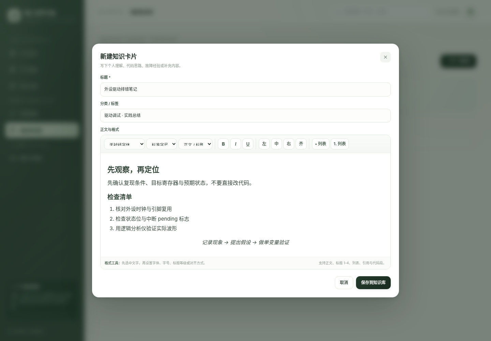
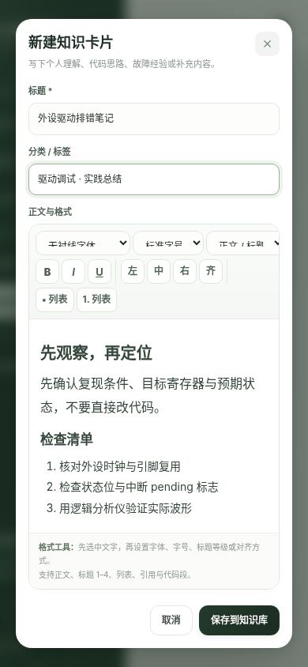
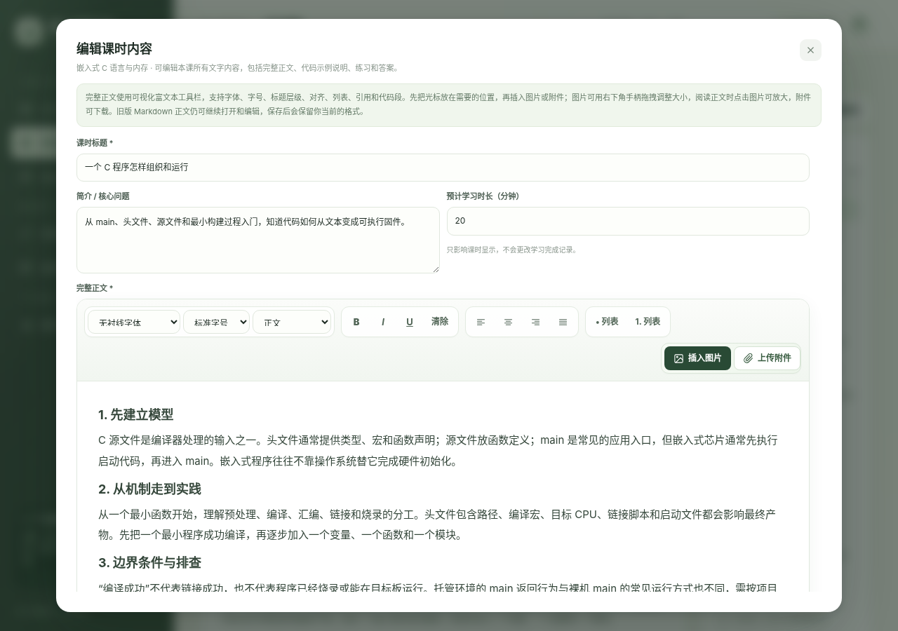
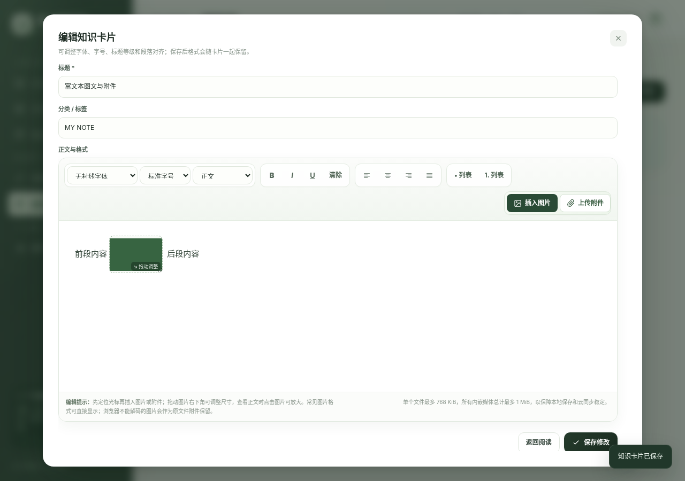
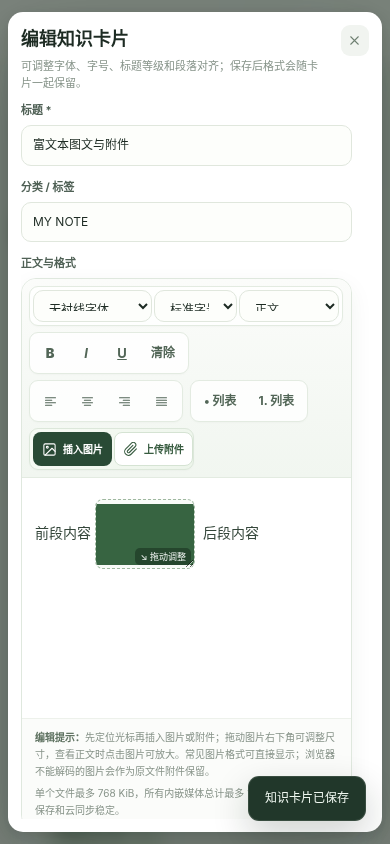
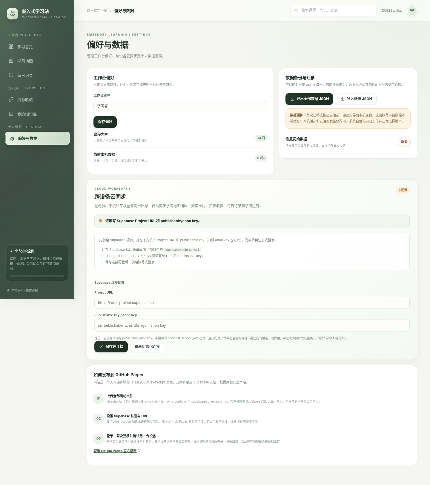

# 嵌入式学习站 · Embedded Learning Station

一个纯 HTML / CSS / JavaScript 的中文嵌入式学习网站，可直接通过 GitHub Pages 发布。前端无需构建；可使用 Supabase Auth 与 PostgreSQL 为个人学习数据提供跨设备云同步。

## 界面预览

**学习总览**

**学习地图**

**每日记录详情与编辑**

**每日记录月历视图**

**每日记录：弹窗新增**

**每日记录：手机端月历**

**资源收藏：详情查看与编辑入口**

**我的知识库：富文本编辑与放大阅读**

**学习地图：完整课时正文富文本编辑**

**知识卡片图文与附件编辑**

**手机端自适应布局**

**跨设备云同步配置界面**

## 界面体验

界面采用暖白底色、深松绿导航与低饱和鼠尾草绿作为主色，使用克制的边框、柔和阴影和更清晰的留白建立层次。顶部导航提供轻量磨砂质感；卡片、按钮、搜索框与弹窗使用统一的缓动曲线和细微位移，避免过度弹跳或长时间装饰动画。首页芯片插画以低频、低幅度动效增加灵动感；同时支持系统“减少动态效果”偏好，并针对窄屏调整布局和字号。

## 功能

- **学习总览**：汇总累计学习时长、课程掌握进度、常用知识模块、最近知识卡片和学习记录。
- **学习地图**：现有 14 个知识模块、133 个内置知识单元（在原有 86 节基础上新增 47 节细分课程）。保留原有 C 语言、计算机底层、MCU 启动、GPIO/中断、定时器/PWM、UART/I²C/SPI、ADC/DMA、RTOS、工具链调试和固件可靠性内容，并补齐 GNU Make/Makefile、GCC 与交叉编译、Binutils、链接器与 map 文件、GDB、汇编与 ABI/EABI、MMU/MPU/Cache、Bootloader、硬件信号完整性、软件设计、模块管理、错误管理、单元测试、代码覆盖率、静态/动态分析和性能分析。
- **学习地图与可编辑课程**：已移除单独的“推荐学习顺序”板块，学习地图聚焦可检索的知识模块；内置 14 个知识模块、133 个知识单元；所有模块标题、分类、级别、预计时长和简介都可以编辑；每个课程阶段的标题与目标、每节课标题、简介、完整正文（含代码示例说明、逐段讲解、练习问题与答案）、要点、参考答案和原书关联都可以编辑并保存。编辑课时和新建课时的正文采用同一套富文本工具栏，支持插入图片、任意类型附件、图片尺寸调整及详情放大；模块、阶段和课时均可删除，模块/阶段删除会提示影响范围并同步清理子内容及完成状态。还可在现有模块中新增课时。旧课程 ID 保留，原有完成进度继续匹配。
- **学习内容详情**：课程卡片可点击进入课程；单元可打开完整正文；支持前后切换、标记完成、课程内导航和把练习带入每日记录。部分单元标注了原书对应章节，方便按书对照学习。
- **每日记录**：以月历和颜色块整理大量学习记录，支持原生日期选择器直接跳转到指定年、月、日；点击日期可查看当天的记录，点击日历色块可直接打开对应记录详情。新增记录改为弹窗表单，不再长期占据页面；详情支持编辑、删除，按类别筛选，并统计学习条数与投入时长。
- **资源收藏**：内置 Arm、CMSIS、STM32、GCC、Git、FreeRTOS、Zephyr 等参考入口；所有资源均支持详情查看、编辑名称/链接/分类/标签/说明，以及从详情或编辑窗口删除。
- **我的知识库富文本编辑**：新建和编辑界面均提供可视化格式工具栏，可设置字体、字号、正文/标题 1–4、引用、代码段、左/中/右/两端对齐、加粗、斜体、下划线和列表。支持在光标所在位置插入图片和附件；图片框可用鼠标或触屏拖动右下角手柄调整尺寸，阅读时点击图片可放大；任何 MIME 类型的文件都可作为下载附件。保存、再次编辑、JSON 备份和已配置的跨设备云同步均保留富文本结构。保存前会按 HTML 白名单清理危险标签和属性。
- **偏好与数据**：自定义工作台称呼；支持导出 JSON、从备份恢复和重置。导出备份包含课程、阶段、课时、增删改记录与个人学习数据。
- **跨模块搜索**：可搜索课程、课程正文、知识卡片、资源和学习记录；点击结果可直接打开课程/课时、查看对应记录详情，或跳转并高亮命中的笔记与资源。
- **本地优先与跨设备同步**：所有修改先保存至浏览器 `localStorage`；配置 Supabase 并登录后会自动上传版本化的个人工作区，通过 Realtime 与 20 秒轮询接收其他设备更新。断网时仍可继续本地编辑；版本冲突会暂停上传并提供“采用云端 / 采用本机”选择，避免静默覆盖。
- **简约视觉与流畅动效**：暖白与深松绿的低饱和配色、磨砂顶部栏、细腻卡片层次、统一缓动、轻量页面入场和弹窗过渡；减少动态效果的系统偏好会自动生效。

## 本次学习地图扩充与结构调整

本版以用户提供的李云《专业嵌入式软件开发：全面走向高质高效编程》作为主题来源，按硬件、工具、编程语言、设计、操作系统和质量保证等方面组织知识地图。原书相关主题用于提供术语和方向；零基础前置概念、部分工程练习及平台适配说明属于为学习路径补充的教学内容，不表示原书一定以同名独立章节展开。

本次重点重构“底层原理和基础知识”，将原本少量大课拆成带明确先后顺序的学习阶段。三个核心基础模块现在分别包含 **22 节 C 语言与内存、18 节计算机底层与数字基础、10 节 MCU 启动与系统架构**，合计 50 个基础单元；其他外设、RTOS、工具链、设计与质量保证模块同样进行了拆分和补充：新增寄存器/栈帧/ABI、预处理与重定位、可重复构建、电气阈值/上拉/去耦、GPIO 消抖/EXTI、定时器计算/输入捕获、UART 缓冲/I²C 恢复/SPI 模式、ADC 采样时序/DMA 所有权、RTOS 优先级反转/超时/临界区、故障恢复/崩溃记录、模块契约/依赖图/资源回滚、测试替身/硬件在环/持续集成等单元。每个模块现在按学习阶段组织，并提供对应阶段目标。课程详情会按学习阶段分组，每阶段附有可检查的学习目标，不再只显示一长串平铺小节。

课程卡片按前置知识组织：**C 语言 → 计算机底层 → 汇编与 ABI/EABI → MCU 启动 → 构建调试 → 硬件接口 → 外设驱动 → RTOS → 可靠性、设计与质量保证**。这只是内容编排，不再单独占用学习地图顶部空间；有项目经验的学习者可以通过搜索直接打开相关课程。

### 全部模块的细化情况

| 学习模块 | 知识单元 | 阶段重点 |
|---|---:|---|
| 嵌入式 C 语言与内存 | 22 | 程序、类型、表达式、函数、对象、数组指针、限定符、内存与资源 |
| 计算机底层与数字基础 | 18 | 数制、数据表示、CPU 执行、地址、存储器、总线、MMIO、保护与 Cache |
| 汇编、栈帧与 ABI/EABI | 6 | 汇编阅读、寄存器、分支、栈帧、参数传递与 ABI |
| MCU 启动流程与系统架构 | 10 | 复位、向量表、运行时初始化、时钟、链接映像、Bootloader 与故障排查 |
| GNU 工具链：构建、分析与调试 | 10 | 预处理、编译参数、Make、目标文件、符号、重定位、map、GDB 与复现构建 |
| 硬件接口与信号完整性 | 6 | 逻辑阈值、上拉、供电去耦、波形测量和板级排障 |
| GPIO、EXTI 与中断 | 6 | 时钟和复用、输入消抖、EXTI、pending 状态、ISR 与延后处理 |
| 定时器、输入捕获与 PWM | 6 | 时基计算、输出比较、捕获、PWM 精度与硬件触发 |
| UART、I²C 与 SPI 通信 | 8 | UART 帧与缓冲、I²C 事务与恢复、SPI 模式、消息分帧 |
| ADC、DMA 与数据采集 | 6 | 模拟前端、采样时间、触发、DMA 模式、所有权和一致性 |
| RTOS 任务与并发 | 11 | 调度、优先级、上下文、同步、资源所有权、内存、设备和超时 |
| 固件可靠性与小型项目 | 6 | 状态机、故障分类、看门狗、复位原因、崩溃现场 |
| 软件设计、模块管理与可维护性 | 10 | 接口契约、依赖图、生命周期、目录、配置与错误处理 |
| 质量保证：测试、分析与性能 | 8 | 单元测试、测试替身、覆盖率、静态/动态分析、硬件在环、CI 与性能 |
| **合计** | **133** | **14 个模块，按阶段目标循序学习** |

C 语言课程按“程序结构和类型 → 表达式与控制流 → 对象作用域和复合类型 → 数组与指针 → 面向固件的限定符/共享数据 → 未定义行为、栈、堆与内存段”递进。计算机底层课程按“数制与数据表示 → CPU 寄存器和指令执行 → 地址空间与存储介质 → 总线与 MMIO → MPU/MMU、Cache 和故障现场”递进。MCU 启动课程按“复位与向量表 → .data/.bss 和运行库初始化 → 时钟配置 → 链接与映像 → 启动故障定位”递进。旧知识单元 ID 保持不变，已记录的完成状态仍可匹配；由于增加了学习单元，整体完成百分比会按新的总单元数重新计算。

### 用户可编辑与删除范围

学习地图不是只读目录。进入地图后可以编辑每个知识模块的标题、分类、级别、时长和简介，也可以在模块编辑窗口删除模块；进入模块后可新增课时、编辑或删除学习阶段与课时。编辑课时时，完整正文、示例代码、说明、步骤、常见问题、要点、练习与参考答案均汇入正文/字段编辑界面，保存后会覆盖原先生成的对应文字内容。删除阶段会同时删除该阶段所含课时，删除模块会移除其下课时与完成记录，操作前会显示影响范围并要求确认。保存后变更会同步反映在地图、课程详情、学习进度与相关搜索结果中。

“我的知识库”支持卡片放大查看；在大尺寸详情视图中可阅读全文，也可进入编辑模式调整标题、分类与正文。富文本编辑器支持字体、字号、标题等级、段落对齐、加粗/斜体/下划线、编号/项目列表、引用与代码段；保存会更新原卡片，格式在详情查看、备份导入导出和云同步中保留。资源收藏同样支持放大查看、编辑和删除；内置资源与用户添加的资源采用相同的交互。

### 当前教学呈现方式

课程统一按“先理解核心概念 → 阅读本节针对性代码/工程示例 → 按步骤追踪输入、状态与输出 → 看常见误区与排查 → 阅读直接问答 → 完成练习并核对参考答案”的顺序呈现。每一节都有明确的学习目标、具体示例、逐段说明，以及已展开显示的练习答案；问答不只提出问题，页面会同时给出解释或推导。对 C/CPU/链接/驱动/RTOS 的通用示例，会标明伪代码、工具链或芯片依赖，避免把说明性代码误当作可直接烧录的完整实现。

图解只放在空间关系、内存布局、位模式、总线事务、时序或状态交接等确实能通过视觉降低理解成本的小节，不再按“每小节必须有图”批量套模板。当前 30 张针对性图解分布在 27 节课程中，图型与课程内容对应，每张图都有专属的读图说明；其他小节优先用代码、手算、操作步骤和排查清单解释，不为凑数添加重复流程图。不同课程的代码示例、图标题和代码标题经过重复性审计。

除基础课程外，全部其余课程也已进一步拆小，补充了可以独立学习和验证的机制主题。全地图现为 14 个模块、133 个内置知识单元；原有的 86 个知识单元 ID 保持不变，新增 47 个主题单元。每课包含主题讲解、学习分析步骤、常见误区和自测/实践任务，避免只列概念名称。

为照顾初学者，每个内置知识单元均在原有正文基础上新增“从零开始建立直觉、一步一步学会分析、初学者常见误区与排查方法、自测：达到什么程度才算掌握”四个部分。内容强调先理解问题与底层机制，再画出执行/数据流程、预测结果、用工具验证，最后主动测试边界条件。示例以通用 C / MCU 工程场景说明。页面只做知识点归纳和通俗化重写，不复制原书大段文字；详细理论与书中示例应以原著为准。书中部分开发环境和工具版本较早，实际操作时请同时核对目标 MCU、编译器与 RTOS 的当前官方文档。

## 跨设备云同步（Supabase）

项目已经包含 Supabase 登录与同步集成。**需要你先创建自己的 Supabase 项目并执行一次数据库 SQL；当前交付包没有你的云端项目凭据，因此尚未连接到实际云端。**

### 1. 创建并配置 Supabase 项目

1. 在 [Supabase](https://supabase.com/) 创建一个项目，并记下数据库密码（仅你自己保管，不需要填进网站）。
2. 打开 Supabase Dashboard 的 **SQL Editor**，执行本项目的 `supabase/schema.sql`。它会建立 `embedded_learning_workspaces` 表、开启 RLS，并只允许已登录用户读写自己 `user_id` 对应的工作区；不会授予客户端删除表记录的权限。
3. 在项目的 Connect / API Keys 页面复制 Project URL 与 **publishable key（推荐）**。旧项目的 `anon` 公共 key 暂时仍可用，但 Supabase 已宣布将在 2026 年底前逐步弃用旧式 `anon` / `service_role` key，建议新项目直接用 `sb_publishable_...`。
4. 部署网站后进入「偏好与数据 → 跨设备云同步 → Supabase 连接配置」，填入 URL 和 key 并保存。若希望网站在每台设备打开时自动带有连接配置，可在部署前编辑 `sync-config.js` 中的 `url` 与 `publishableKey`。公开 publishable key 可存在浏览器代码中，但**绝不能把 `service_role` 或 `sb_secret_...` 密钥放在前端**。参考：[Supabase API keys 官方说明](https://supabase.com/docs/guides/getting-started/api-keys)。
5. 在 Supabase Authentication 设置中确认启用了 Email 登录，并将实际 GitHub Pages 站点地址加入允许的 Site URL / Redirect URLs。若开启邮箱确认，首次注册后需要点击验证邮件再登录。

### 2. 在网站里登录并迁移数据

1. 在「偏好与数据 → 跨设备云同步」创建账号或登录。
2. 如果云端还是空的，点击 **将此设备的数据迁移到云端**。这是显式操作，不会在你没确认时自动上传覆盖。
3. 在其他设备打开同一个 GitHub Pages 地址。如果你没有把默认连接信息写入 `sync-config.js`，先在「Supabase 连接配置」中再次填写相同的 Project URL 与 publishable key（该配置只保存在当前设备的浏览器里），然后使用同一个账号登录。如果账号已有云端工作区，选择 **从云端恢复到此设备**；这一操作会覆盖这台设备当前的本地工作区，建议事先导出 JSON 备份。
4. 登录并完成首次关联后，学习地图编辑、完成状态、知识卡片、资源收藏、每日记录与工作台偏好都会参与同步。

### 3. 数据同步与冲突安全

- 所有现有编辑仍先保存本机，然后在短暂防抖后上传；网络暂时不可用时保留本机数据并重试。单次云端写入串行执行；如果上传期间又有新编辑，会在当前上传完成后继续上传，避免旧快照清掉新变更。
- 通过数据库行 `revision` 做乐观并发检查。若其他设备先修改了云端，当前设备不会直接覆盖，而是在同步面板提供两个明确选项：采用云端版本（覆盖本机）或采用本机版本（覆盖云端）。选择前建议导出 JSON 备份。
- 登录另一个新设备时，若云端已存在数据，不会静默把该设备初始数据上传覆盖；需要明确选择恢复或覆盖。
- 账号退出不会清除当前浏览器缓存。存在未处理冲突时会阻止退出；同步中的新编辑会排队上传，未完成上传时会提示先等待同步。共享设备上退出账号后，本机缓存仍会保留，请只在个人设备上使用或在离开前清理浏览器数据。
- 支持通过 Supabase 邮件发起密码重置，并在返回网站后设置新密码。
- 当前版本把每个账号的可编辑数据存为一个版本化 JSON 工作区，适合个人学习站。若将来需要多用户协作、细粒度历史版本/合并或文件附件，再考虑将记录拆成多张数据库表。

### 4. 部署文件

发布到 GitHub Pages 时，以下文件需要保留在网站根目录：

- `index.html`：站点界面与现有学习功能。
- `sync-client.js`：Supabase Auth、云端保存/恢复、冲突检查与 Realtime 监听。
- `sync-config.js`：可选的公开默认连接配置；不填写时也能在站点设置里配置。
- `.nojekyll`、`README.md` 及预览图。
- `supabase/schema.sql` 与 `supabase/tests/workspaces_rls.test.sql` 是数据库配置与测试文件；可随代码仓库保存，但 SQL 只需在 Supabase SQL Editor 执行，不作为网页脚本加载。

Supabase JS SDK 通过固定版本的 jsDelivr CDN 加载。如果你的网络屏蔽该 CDN，网站本地学习功能仍可用，但云同步脚本无法工作；需要允许该域名或自行托管 SDK。

## 本地预览

建议通过 GitHub Pages 访问，或启动一个本地 HTTP 服务后预览；直接用 `file://` 打开时，部分浏览器会限制 `localStorage`，导致数据无法持久保存。

本地预览示例（需安装 Python）：在该目录执行 `python -m http.server 8000`，然后打开 `http://localhost:8000`。建议使用现代版 Chrome、Edge、Firefox 或 Safari。

## 部署到 GitHub Pages

1. 在 GitHub 创建仓库，例如 `embedded-learning-hub`。
2. 将本项目 ZIP 解压后，**把项目根目录中的全部发布文件和 `supabase/` 目录一并提交**，至少必须包含 `index.html`、`sync-client.js`、`sync-config.js` 和 `.nojekyll`。如果只上传 `index.html`，本地学习页面可能显示，但跨设备同步模块会无法加载。
3. 打开仓库 **Settings → Pages**。
4. 在 **Build and deployment** 中将 Source 设为 **Deploy from a branch**。
5. Branch 选择 `main`，目录选择 `/(root)`，点击 **Save**。
6. 部署完成后使用 GitHub Pages 提供的站点地址访问。

GitHub Pages 可直接发布仓库中的静态文件。GitHub Free 账号的 Pages 通常要求源仓库为公开仓库；发布出的网站可能公开可访问。请勿把个人隐私、账号凭据或敏感数据写入网站代码。

## 数据保存与隐私说明

不配置 Supabase 时，网站仍以**当前浏览器本地存储**为主要数据源。配置并登录 Supabase 后，可开启跨设备自动同步。清除浏览器站点数据可能导致尚未上传的数据丢失；请留意同步状态并定期导出 JSON 备份。不要把私人学习记录直接提交到公开 Git 仓库。

## 文件说明

- `index.html`：网站页面、样式、课程内容和交互逻辑。
- `sync-client.js`：Supabase 登录、同步与冲突处理。
- `sync-config.js`：Supabase 公共默认配置（可留空）。
- `supabase/schema.sql`：数据库表、RLS 权限和 Realtime 设置。
- `supabase/tests/workspaces_rls.test.sql`：基础数据库结构/RLS 检查。
- `README.md`：功能、云同步配置与部署说明。
- `.nojekyll`：避免静态项目被 Jekyll 处理时出现不必要的路径问题。

## 富文本正文、图片与附件

“我的知识库”与“学习地图 → 编辑课时内容”的完整正文使用同一套富文本工具栏。工具栏采用类似 Word/Excel 的分组功能区，支持字体、字号、正文/标题等级、加粗/斜体/下划线/删除线、上标与下标、文字颜色与高亮、撤销/重做、段落对齐、缩进、项目符号与编号列表、超链接、表格、分隔线、引用和代码段；图片和附件可以插入在光标所在的任意正文位置。图片可以拖动右下角手柄调整宽高，改变后的尺寸会写回正文并随保存保留；查看详情时点击图片可放大。触屏设备也支持拖动手柄。任何 MIME 类型的文件都可作为附件插入，查看正文时点击附件即可下载。

常见浏览器支持的图片格式可直接显示（例如 PNG、JPEG、GIF、WebP、SVG 和 AVIF，具体取决于浏览器能力）。如果浏览器无法解码某种特殊图片格式，原始文件会自动作为附件插入，不会因为预览失败而丢失。为避免静态网站浏览器本地存储和云端 JSON 快照被大型二进制数据撑满，目前单个图片/附件大小上限为 768 KiB，所有知识库与课时正文中的内嵌媒体总量上限为 1 MiB。附件不会上传到公开文件托管服务，而是内嵌在当前用户的数据中，并随 JSON 备份及已配置的云同步一起保存。
