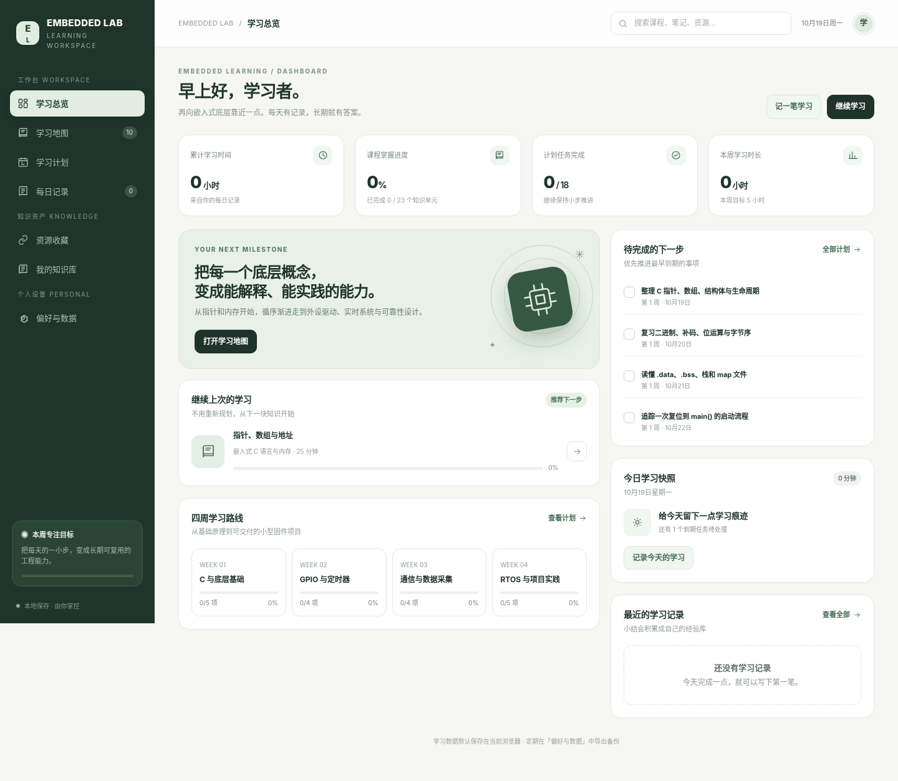
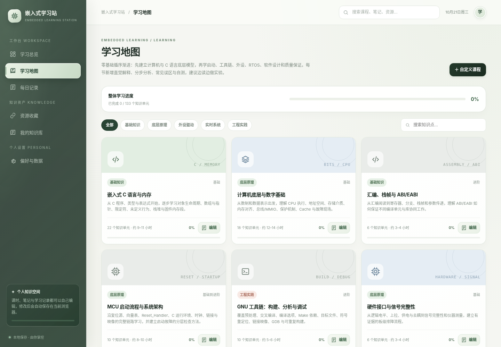
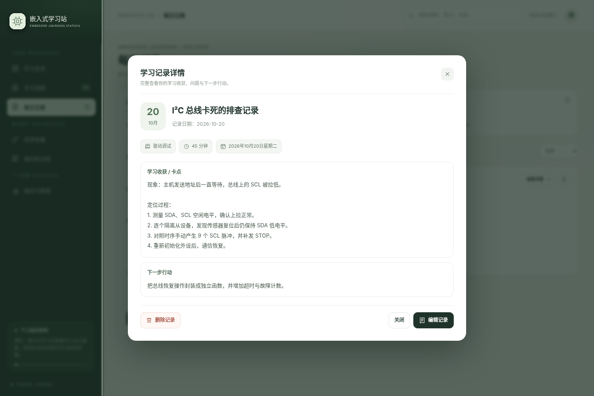
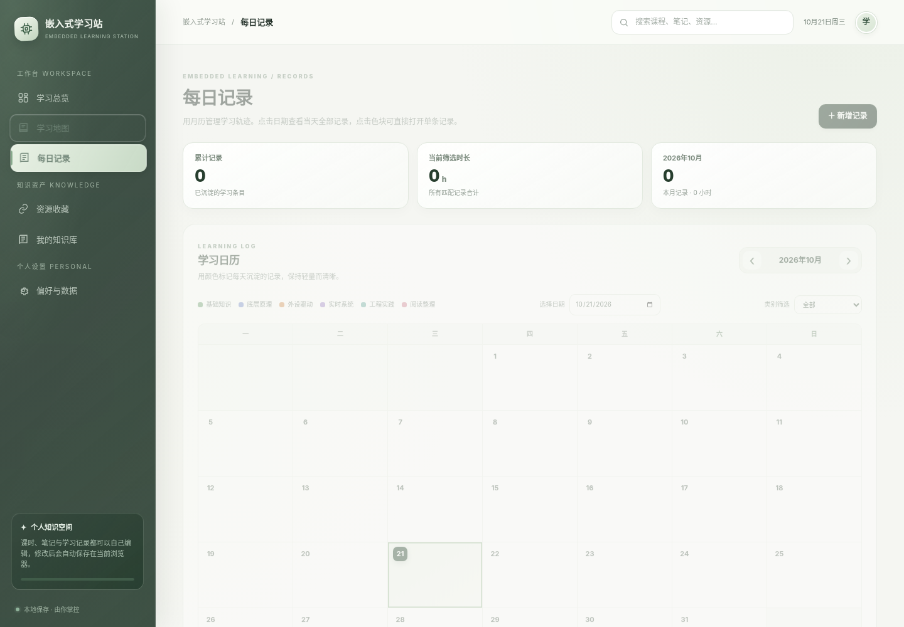
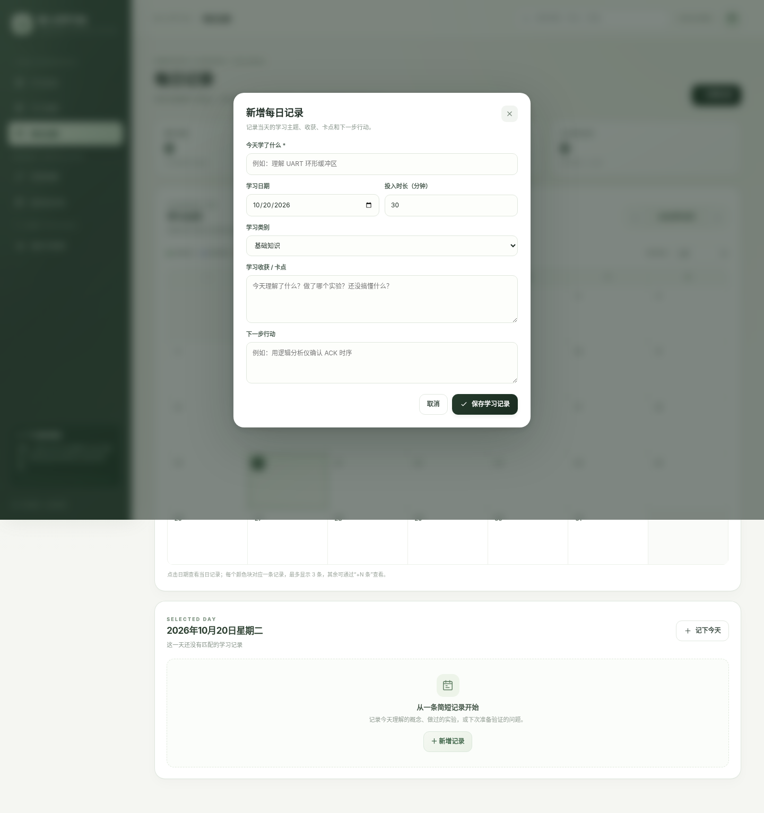
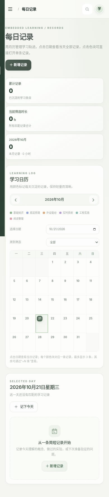
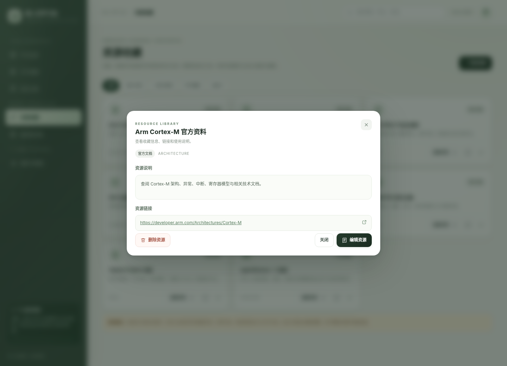
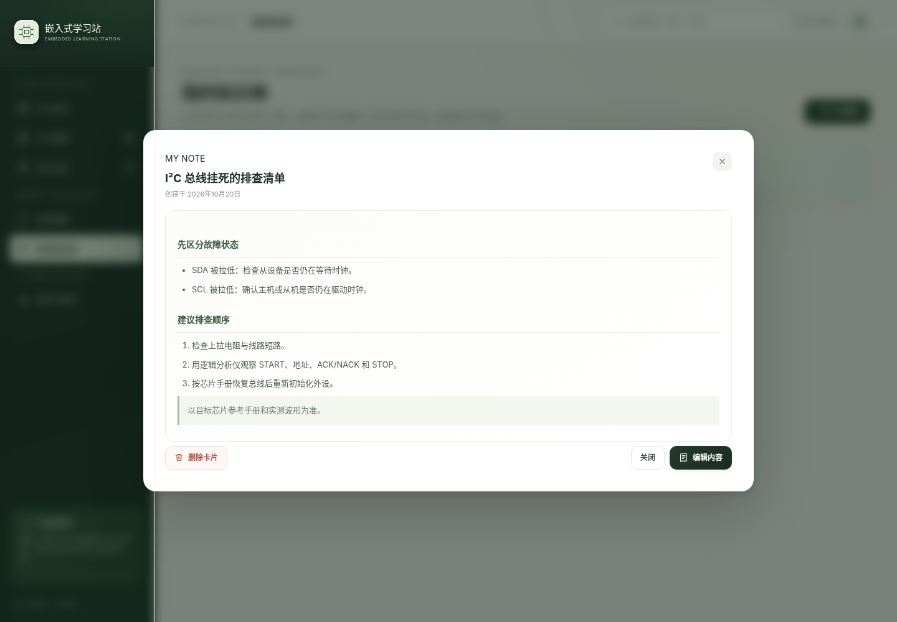

# Embedded Lab · 嵌入式学习工作台

一个纯 HTML / CSS / JavaScript 的中文嵌入式学习网站，可直接通过 GitHub Pages 发布。无需安装 Node.js、无需构建、无需后端。

## 界面预览

**学习总览**

**学习地图**

**每日记录详情与编辑**

**每日记录月历视图**

**每日记录：弹窗新增**

**每日记录：手机端月历**

**资源收藏：详情查看与编辑入口**

**我的知识库：放大阅读与编辑**

**手机端自适应布局**

## 界面体验

界面采用暖白底色、深松绿导航与低饱和鼠尾草绿作为主色，使用克制的边框、柔和阴影和更清晰的留白建立层次。顶部导航提供轻量磨砂质感；卡片、按钮、搜索框与弹窗使用统一的缓动曲线和细微位移，避免过度弹跳或长时间装饰动画。首页芯片插画以低频、低幅度动效增加灵动感；同时支持系统“减少动态效果”偏好，并针对窄屏调整布局和字号。

## 功能

- **学习总览**：汇总累计学习时长、课程掌握进度、常用知识模块、最近知识卡片和学习记录。
- **学习地图**：现有 14 个知识模块、133 个内置知识单元（在原有 86 节基础上新增 47 节细分课程）。保留原有 C 语言、计算机底层、MCU 启动、GPIO/中断、定时器/PWM、UART/I²C/SPI、ADC/DMA、RTOS、工具链调试和固件可靠性内容，并补齐 GNU Make/Makefile、GCC 与交叉编译、Binutils、链接器与 map 文件、GDB、汇编与 ABI/EABI、MMU/MPU/Cache、Bootloader、硬件信号完整性、软件设计、模块管理、错误管理、单元测试、代码覆盖率、静态/动态分析和性能分析。
- **学习地图与可编辑课程**：已移除单独的“推荐学习顺序”板块，学习地图聚焦可检索的知识模块；内置 14 个知识模块、133 个知识单元；所有模块标题、分类、级别、预计时长和简介都可以编辑；每个课程阶段的标题与目标、每节课标题、简介、完整正文（含代码示例说明、逐段讲解、练习问题与答案）、要点、参考答案和原书关联都可以编辑并保存；模块、阶段和课时均可删除，模块/阶段删除会提示影响范围并同步清理子内容及完成状态。还可在现有模块中新增课时。旧课程 ID 保留，原有完成进度继续匹配。
- **学习内容详情**：课程卡片可点击进入课程；单元可打开完整正文；支持前后切换、标记完成、课程内导航和把练习带入每日记录。部分单元标注了原书对应章节，方便按书对照学习。
- **每日记录**：以月历和颜色块整理大量学习记录，支持原生日期选择器直接跳转到指定年、月、日；点击日期可查看当天的记录，点击日历色块可直接打开对应记录详情。新增记录改为弹窗表单，不再长期占据页面；详情支持编辑、删除，按类别筛选，并统计学习条数与投入时长。
- **资源收藏**：内置 Arm、CMSIS、STM32、GCC、Git、FreeRTOS、Zephyr 等参考入口；所有资源均支持详情查看、编辑名称/链接/分类/标签/说明，以及从详情或编辑窗口删除。
- **我的知识库**：自由增加个人笔记、代码模式、排错记录和项目复盘。卡片可放大进入大尺寸阅读视图，也可直接编辑标题、分类与完整正文；修改会覆盖原卡片，并保存在当前浏览器。
- **偏好与数据**：自定义工作台称呼；支持导出 JSON、从备份恢复和重置。导出备份包含课程、阶段、课时、增删改记录与个人学习数据。
- **跨模块搜索**：可搜索课程、课程正文、知识卡片、资源和学习记录；点击结果可直接打开课程/课时、查看对应记录详情，或跳转并高亮命中的笔记与资源。
- **本地持久化**：学习进度、课程与阶段编辑、新增/删除课时、模块删除、笔记、资源和记录会保存在当前浏览器的 `localStorage`。
- **简约视觉与流畅动效**：暖白与深松绿的低饱和配色、磨砂顶部栏、细腻卡片层次、统一缓动、轻量页面入场和弹窗过渡；减少动态效果的系统偏好会自动生效。

## 本次学习地图扩充与结构调整

本版以用户提供的李云《专业嵌入式软件开发：全面走向高质高效编程》作为主题来源，按硬件、工具、编程语言、设计、操作系统和质量保证等方面组织知识地图。原书相关主题用于提供术语和方向；零基础前置概念、部分工程练习及平台适配说明属于为学习路径补充的教学内容，不表示原书一定以同名独立章节展开。

本次重点重构“底层原理和基础知识”，将原本少量大课拆成带明确先后顺序的学习阶段。三个核心基础模块现在分别包含 **22 节 C 语言与内存、18 节计算机底层与数字基础、10 节 MCU 启动与系统架构**，合计 50 个基础单元；其他外设、RTOS、工具链、设计与质量保证模块同样进行了拆分和补充：新增寄存器/栈帧/ABI、预处理与重定位、可重复构建、电气阈值/上拉/去耦、GPIO 消抖/EXTI、定时器计算/输入捕获、UART 缓冲/I²C 恢复/SPI 模式、ADC 采样时序/DMA 所有权、RTOS 优先级反转/超时/临界区、故障恢复/崩溃记录、模块契约/依赖图/资源回滚、测试替身/硬件在环/持续集成等单元。每个模块现在按学习阶段组织，并提供对应阶段目标。课程详情会按学习阶段分组，每阶段附有可检查的学习目标，不再只显示一长串平铺小节。

课程卡片按前置知识组织：**C 语言 → 计算机底层 → 汇编与 ABI/EABI → MCU 启动 → 构建调试 → 硬件接口 → 外设驱动 → RTOS → 可靠性、设计与质量保证**。这只是内容编排，不再单独占用学习地图顶部空间；有项目经验的学习者可以通过搜索直接打开相关课程。

### 全部模块的细化情况

| 学习模块 | 知识单元 | 阶段重点 |
|---|---:|---|
| 嵌入式 C 语言与内存 | 22 | 程序、类型、表达式、函数、对象、数组指针、限定符、内存与资源 |
| 计算机底层与数字基础 | 18 | 数制、数据表示、CPU 执行、地址、存储器、总线、MMIO、保护与 Cache |
| 汇编、栈帧与 ABI/EABI | 6 | 汇编阅读、寄存器、分支、栈帧、参数传递与 ABI |
| MCU 启动流程与系统架构 | 10 | 复位、向量表、运行时初始化、时钟、链接映像、Bootloader 与故障排查 |
| GNU 工具链：构建、分析与调试 | 10 | 预处理、编译参数、Make、目标文件、符号、重定位、map、GDB 与复现构建 |
| 硬件接口与信号完整性 | 6 | 逻辑阈值、上拉、供电去耦、波形测量和板级排障 |
| GPIO、EXTI 与中断 | 6 | 时钟和复用、输入消抖、EXTI、pending 状态、ISR 与延后处理 |
| 定时器、输入捕获与 PWM | 6 | 时基计算、输出比较、捕获、PWM 精度与硬件触发 |
| UART、I²C 与 SPI 通信 | 8 | UART 帧与缓冲、I²C 事务与恢复、SPI 模式、消息分帧 |
| ADC、DMA 与数据采集 | 6 | 模拟前端、采样时间、触发、DMA 模式、所有权和一致性 |
| RTOS 任务与并发 | 11 | 调度、优先级、上下文、同步、资源所有权、内存、设备和超时 |
| 固件可靠性与小型项目 | 6 | 状态机、故障分类、看门狗、复位原因、崩溃现场 |
| 软件设计、模块管理与可维护性 | 10 | 接口契约、依赖图、生命周期、目录、配置与错误处理 |
| 质量保证：测试、分析与性能 | 8 | 单元测试、测试替身、覆盖率、静态/动态分析、硬件在环、CI 与性能 |
| **合计** | **133** | **14 个模块，按阶段目标循序学习** |

C 语言课程按“程序结构和类型 → 表达式与控制流 → 对象作用域和复合类型 → 数组与指针 → 面向固件的限定符/共享数据 → 未定义行为、栈、堆与内存段”递进。计算机底层课程按“数制与数据表示 → CPU 寄存器和指令执行 → 地址空间与存储介质 → 总线与 MMIO → MPU/MMU、Cache 和故障现场”递进。MCU 启动课程按“复位与向量表 → .data/.bss 和运行库初始化 → 时钟配置 → 链接与映像 → 启动故障定位”递进。旧知识单元 ID 保持不变，已记录的完成状态仍可匹配；由于增加了学习单元，整体完成百分比会按新的总单元数重新计算。

### 用户可编辑与删除范围

学习地图不是只读目录。进入地图后可以编辑每个知识模块的标题、分类、级别、时长和简介，也可以在模块编辑窗口删除模块；进入模块后可新增课时、编辑或删除学习阶段与课时。编辑课时时，完整正文、示例代码、说明、步骤、常见问题、要点、练习与参考答案均汇入正文/字段编辑界面，保存后会覆盖原先生成的对应文字内容。删除阶段会同时删除该阶段所含课时，删除模块会移除其下课时与完成记录，操作前会显示影响范围并要求确认。保存后变更会同步反映在地图、课程详情、学习进度与相关搜索结果中。

“我的知识库”支持卡片放大查看；在大尺寸详情视图中可阅读全文，也可进入编辑模式调整标题、分类与正文。保存会更新原卡片。资源收藏同样支持放大查看、编辑和删除；内置资源与用户添加的资源采用相同的交互。

### 当前教学呈现方式

课程统一按“先理解核心概念 → 阅读本节针对性代码/工程示例 → 按步骤追踪输入、状态与输出 → 看常见误区与排查 → 阅读直接问答 → 完成练习并核对参考答案”的顺序呈现。每一节都有明确的学习目标、具体示例、逐段说明，以及已展开显示的练习答案；问答不只提出问题，页面会同时给出解释或推导。对 C/CPU/链接/驱动/RTOS 的通用示例，会标明伪代码、工具链或芯片依赖，避免把说明性代码误当作可直接烧录的完整实现。

图解只放在空间关系、内存布局、位模式、总线事务、时序或状态交接等确实能通过视觉降低理解成本的小节，不再按“每小节必须有图”批量套模板。当前 30 张针对性图解分布在 27 节课程中，图型与课程内容对应，每张图都有专属的读图说明；其他小节优先用代码、手算、操作步骤和排查清单解释，不为凑数添加重复流程图。不同课程的代码示例、图标题和代码标题经过重复性审计。

除基础课程外，全部其余课程也已进一步拆小，补充了可以独立学习和验证的机制主题。全地图现为 14 个模块、133 个内置知识单元；原有的 86 个知识单元 ID 保持不变，新增 47 个主题单元。每课包含主题讲解、学习分析步骤、常见误区和自测/实践任务，避免只列概念名称。

为照顾初学者，每个内置知识单元均在原有正文基础上新增“从零开始建立直觉、一步一步学会分析、初学者常见误区与排查方法、自测：达到什么程度才算掌握”四个部分。内容强调先理解问题与底层机制，再画出执行/数据流程、预测结果、用工具验证，最后主动测试边界条件。示例以通用 C / MCU 工程场景说明。页面只做知识点归纳和通俗化重写，不复制原书大段文字；详细理论与书中示例应以原著为准。书中部分开发环境和工具版本较早，实际操作时请同时核对目标 MCU、编译器与 RTOS 的当前官方文档。

## 本地预览

建议通过 GitHub Pages 访问，或启动一个本地 HTTP 服务后预览；直接用 `file://` 打开时，部分浏览器会限制 `localStorage`，导致数据无法持久保存。

本地预览示例（需安装 Python）：在该目录执行 `python -m http.server 8000`，然后打开 `http://localhost:8000`。建议使用现代版 Chrome、Edge、Firefox 或 Safari。

## 部署到 GitHub Pages

1. 在 GitHub 创建仓库，例如 `embedded-learning-hub`。
2. 将 `index.html`、`README.md` 上传到仓库根目录并提交。
3. 打开仓库 **Settings → Pages**。
4. 在 **Build and deployment** 中将 Source 设为 **Deploy from a branch**。
5. Branch 选择 `main`，目录选择 `/(root)`，点击 **Save**。
6. 部署完成后使用 GitHub Pages 提供的站点地址访问。

GitHub Pages 可直接发布仓库中的静态文件。GitHub Free 账号的 Pages 通常要求源仓库为公开仓库；发布出的网站可能公开可访问。请勿把个人隐私、账号凭据或敏感数据写入网站代码。

## 数据保存与隐私说明

这是一个静态前端原型，没有用户登录或云端数据库。学习记录、课程编辑、学习进度、自定义课程和知识卡片只存放于**当前浏览器的本地存储**，不会自动同步到 GitHub，也不会自动同步到其他设备。清除浏览器站点数据可能导致本地内容丢失，请定期在「偏好与数据」里导出 JSON 备份。备份会包含学习地图的自定义标题与内容；导入备份会覆盖当前浏览器中的学习数据。

如果后续要支持账号登录、多设备实时同步或多人共享，需要为它增加后端服务和认证/权限控制（例如 Supabase、Firebase 或自建 API），不应把私人学习记录直接提交到公开 Git 仓库。

## 文件说明

- `index.html`：自包含的网站源码（页面、样式、课程数据和交互逻辑）。
- `README.md`：功能与部署说明。
- `.nojekyll`：避免静态项目被 Jekyll 处理时出现不必要的路径问题。
